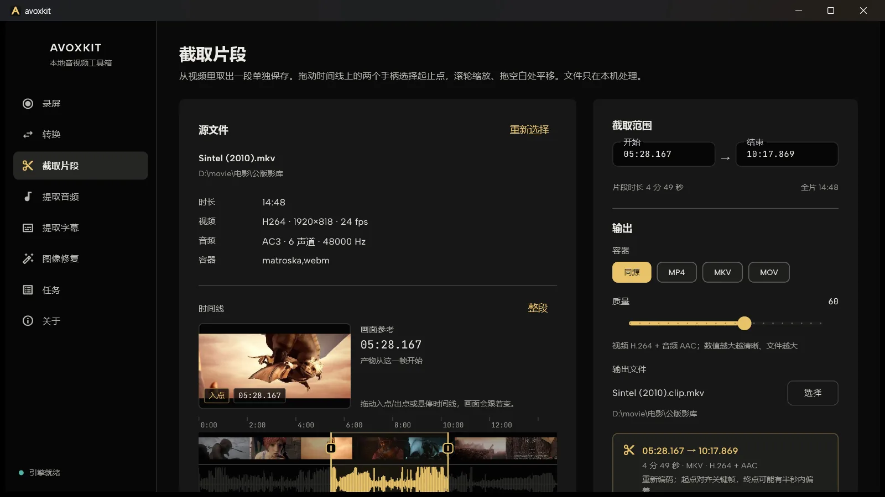
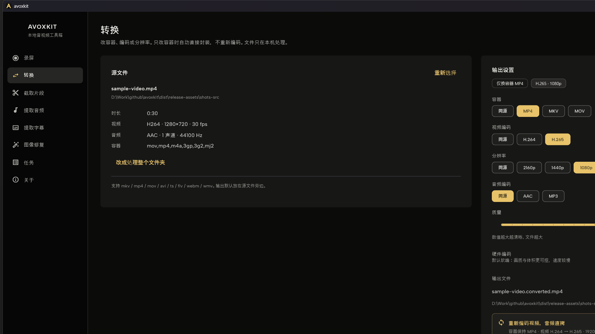
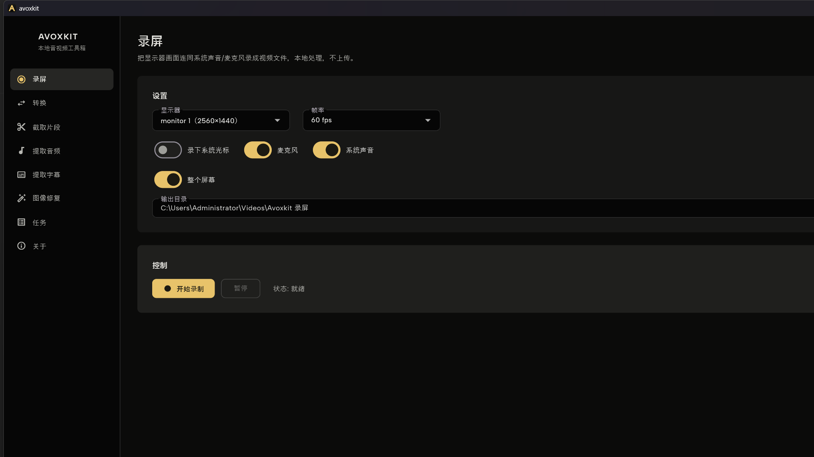
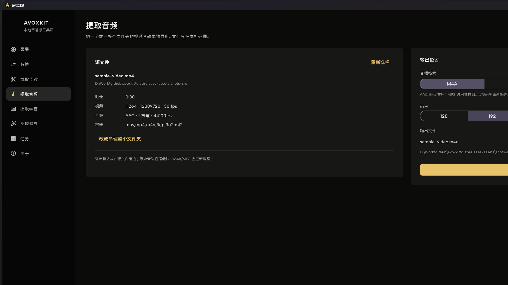
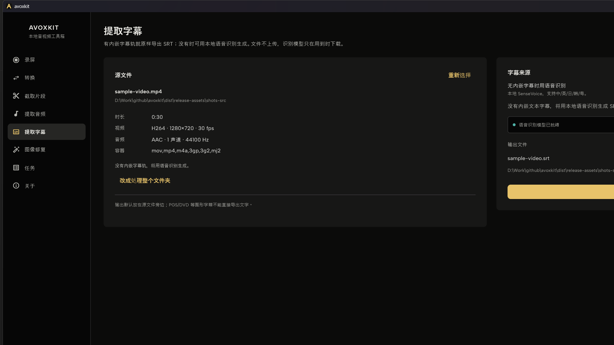
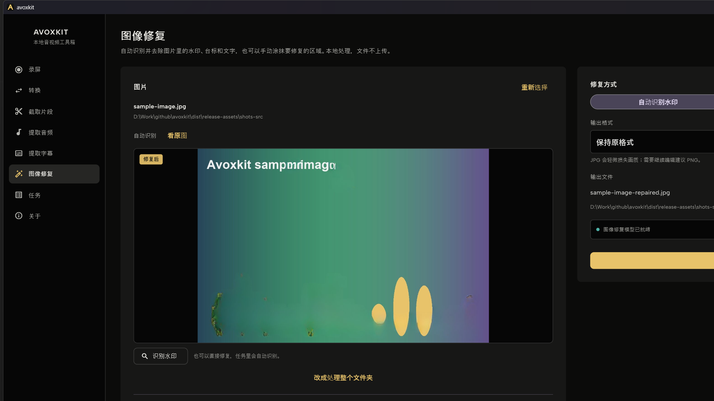
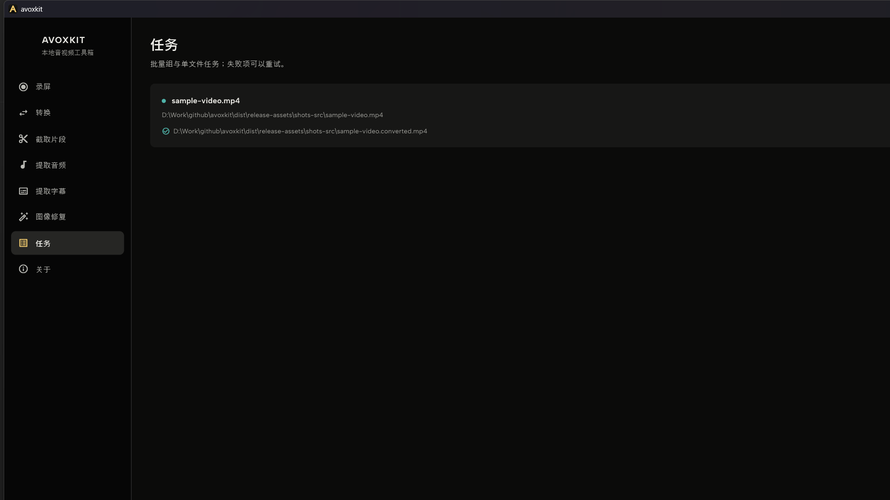

# Avoxkit — Free Video Converter, Screen Recorder, Subtitle Extractor & Image Watermark Remover

**English | [简体中文](README.zh-CN.md)**

*Avoxkit 0.1.0 Trim page on Windows: a frame reference above the thumbnail, waveform and keyframe timeline. Drag the handles or type a time; the preview follows as you move.*

*Preview frame: Sintel (© Blender Foundation, CC BY 3.0).*

**Avoxkit is a free, offline video converter, screen recorder and audio/video toolbox for Windows and macOS.** Convert MP4, MKV and MOV, re-encode to H.264 or H.265, record your screen at 30 or 60 fps, trim a clip, extract audio from video, export or generate SRT subtitles with on-device speech recognition, and remove watermarks from images — without uploading a single file.

All media processing happens locally: no account, no subscription, no output watermark and no telemetry. Avoxkit is built for everyday processing — convert this file, cut this clip, pull the audio or subtitles, clean up an image — not for multi-track video editing.

## Why Avoxkit

- **Free** — every feature is free. No subscription, no paid tier, no watermark on your output.
- **Local** — media is processed on your computer. Files are never uploaded, and there is no cloud processing.
- **No account** — no sign-up, no sign-in, no telemetry. Optional on-device models are downloaded on demand; your media stays on your disk.

## Download Avoxkit for Windows and macOS

[**Download the latest release →**](https://github.com/xxxzhou/avoxkit/releases/latest) — free · Windows x64 · macOS arm64 (Apple Silicon) · v0.1.0 · released 2026-10-31. No account · No watermark · No upload. The macOS build is Developer ID signed and notarized.

Direct downloads: [Windows x64 ZIP](https://github.com/xxxzhou/avoxkit/releases/download/v0.1.0/Avoxkit-0.1.0-windows-x64.zip) · [macOS arm64 DMG](https://github.com/xxxzhou/avoxkit/releases/download/v0.1.0/Avoxkit-0.1.0-arm64.dmg)

[All releases](https://github.com/xxxzhou/avoxkit/releases)

## What Avoxkit does

Six everyday tools share one interface. Convert, trim, extract audio, extract subtitles and image repair also share one task queue; screen recording has its own capture and export flow. Detailed behavior and limits are in **[docs/features.md](docs/features.md)** (currently in Chinese).

### Video converter: MP4, MKV, MOV, H.264 and H.265

Change the container, video codec, resolution or audio codec. If only the container changes and the target container supports the source codecs, Avoxkit remuxes the file instead of re-encoding it. When re-encoding is needed, choose H.264 or H.265, 2160p down to 480p, AAC or MP3 audio, quality from 0 to 100, or a target file size in MB.

- Input formats: MKV, MP4, MOV, AVI, TS, FLV, WebM, WMV and M4V; output containers: MP4, MKV and MOV.
- Factory presets include remux-to-MP4, H.265 1080p, H.264 1080p and a 25 MB target; save your own presets for reuse.
- Hardware encoding is optional when a usable encoder is detected; software encoding is the default.
- Remuxing still reads and writes the whole file, so it is not instant on slow or network drives.

*Avoxkit's converter handles both format conversion and container remuxing. The page shows what will happen before the task is submitted.*

### Screen recorder: display or fixed region, 30 or 60 fps

Record a display, or a fixed region starting at the display's top-left corner, at 30 or 60 fps. Microphone and system audio have separate switches (system audio is Windows-only in 0.1.0). After stopping, export an H.264 + AAC MP4 with a dark gradient background, padding, rounded corners and a shadow.

- Each recording gets a timestamped folder with the original capture, a mixed preview MP4 and a project file for re-export.
- The system cursor is not burned into the original capture by default; it is redrawn on export. Turn the option on to record it directly.
- Landscape output is 1920×1080, portrait 1080×1920 and square 1080×1080; the app window is excluded from the recording.
- No camera picture-in-picture, and the export framing is fixed: no zoom, crop, segments or custom background in 0.1.0.

*Record a display or a fixed region at 30 or 60 fps, with microphone and system audio (system audio is Windows-only).*

### Video trimmer: thumbnail, waveform and keyframe timeline

The trim page is an interval ruler rather than a player. Thumbnails are sampled evenly across the file; when there is an audio track, its waveform is drawn underneath, and keyframes are marked as ticks. Drag the two handles to set in and out points, or type a time in `hh:mm:ss.mmm`, `mm:ss` or seconds.

- Scroll to zoom around the pointer, drag empty space to pan, and double-click to return to the full clip.
- The start snaps to the nearest preceding keyframe; the end is cut by time and may differ by up to about half a second. The minimum clip is 0.1 seconds.
- Clips are re-encoded, **not losslessly cut**: H.264 or H.265 video with AAC audio; the container can be the source, MP4, MKV or MOV.
- Output goes next to the source with `.clip` added before the extension; quality is adjustable from 0 to 100.

### Extract audio from video: M4A, MP3 or the original track

Pull the first audio track out of a video, one file or a whole folder. Choose M4A (AAC) or MP3 at 128, 192, 256 or 320 kbps; for a single file you can also export the original track without re-encoding — if the target container rejects its codec, Avoxkit re-encodes it automatically.

- Folder batches offer M4A and MP3; files without an audio track are rejected at submit time without blocking the rest.
- Output goes next to the source by default; folder mode can keep the subdirectory structure or flatten it.
- In folder batches, existing outputs are skipped by default.

*Extract the first audio track as M4A or MP3 at 128–320 kbps, or export the original track without re-encoding; if the target container rejects its codec, Avoxkit re-encodes automatically.*

### Subtitle extractor and speech to text: SRT on device

If a video has an embedded text subtitle track, Avoxkit exports it as SRT; if it does not, the subtitle extractor generates one with on-device speech recognition. Nothing is uploaded.

- The default text track is selected automatically (Chinese is preferred when there is no default), or you can choose a specific track.
- Embedded SRT, ASS/SSA, WebVTT and mov_text tracks can be read and exported as SRT. PGS, DVD and DVB image subtitles cannot be converted to text; the app points you to speech recognition instead.
- Speech recognition runs on SenseVoice with Silero VAD and supports Chinese, English, Japanese, Korean and Cantonese.
- Models are not bundled: the first run downloads about 230 MB with SHA-256 verification, then recognition works offline.

*When a file has no embedded text subtitles, Avoxkit generates an SRT with on-device SenseVoice recognition. The model is downloaded once and then runs offline.*

### Remove a watermark from an image: auto-detect or brush

Remove watermarks, station logos and overlay text from images. Automatic mode detects likely watermark areas on-device, then LaMa inpainting fills in the background; manual mode lets you paint the area yourself and repairs only that region.

- Automatic detection suits watermarks in varying positions; manual brushing suits known logos, corner marks or text and applies to a single image only.
- The preview marks detected areas and switches to the repaired result; switch back to the original for comparison.
- Input: JPG, JPEG, PNG, BMP, WebP and TGA. Output: JPG, PNG, BMP or TGA; "keep original format" follows the source, and WebP input produces PNG.
- Folder batches use automatic detection only; images where nothing is detected are skipped and marked in the task list.
- Models are downloaded on demand (~290 MB, SHA-256 verified) and are not bundled. Inpainting is generative, so keep the original for important images.

*The image repair page in auto-detect mode: the preview shows the repaired result, with a switch back to the original for comparison.*

### Batch video processing and the task queue

Convert, trim, extract audio, extract subtitles and image repair share one queue. A batch can hold a folder of videos or images, and the task page shows progress, queue position, failures and output paths.

- Jobs run one at a time by default, so encoders do not compete for the GPU and disk.
- Batch groups show total, done, failed, running, queued and skipped counts; groups over 20 items are collapsed. Cancel a whole group or retry its failed items.
- Optional after-completion action: notify, sleep or shut down. It fires only when every queued job finishes normally; shutdown has a 60-second delay and can be cancelled. The choice resets on restart.
- Windows shows an in-progress video frame or audio envelope while re-encoding; macOS shows progress only.
- Outputs are written to a temporary file first; failed or cancelled jobs clean it up. Batch conversions, audio and subtitle exports skip existing outputs.
- Folder scans are capped at 5,000 files. History is stored locally; jobs interrupted by an exit are marked and can be requeued manually, not resumed automatically.

*One queue for single files and batch groups, with progress, cancellation and retry. This view shows a completed conversion.*

## Privacy: files never leave your computer

- Media files are read and written locally; they are never uploaded or processed in the cloud.
- There is no account system, no usage data collection, no advertising and no watermark.
- Apart from downloading the optional speech and image-repair models, conversion, recording, trimming, audio extraction and embedded-subtitle export need no internet.
- Model downloads fetch model files only; your media is not read or sent.
- The app contains no telemetry, cloud sync or automatic upload logic. Task history stays in the local app data directory.

Read the full [privacy policy](PRIVACY.md).

## FAQ

- **Is Avoxkit really free?** Yes. Every feature in 0.1.0 is free, with no subscription, no paid tier and no watermark on your output.
- **Does Avoxkit upload my videos, images or audio?** No. Media is read from and written to your own disk. There is no account, no cloud processing and no telemetry. Optional on-device models for speech recognition and image repair are downloaded on demand; your media is not part of those requests.
- **Do I need an account or an internet connection?** No account. Conversion, screen recording, trimming, audio extraction and embedded-subtitle export work without internet. Speech recognition (~230 MB) and image repair (~290 MB) download their models once, then run offline.
- **Which formats can Avoxkit convert?** Input: MKV, MP4, MOV, AVI, TS, FLV, WebM, WMV and M4V. Output containers: MP4, MKV and MOV, with H.264 or H.265 video and AAC or MP3 audio. When only the container changes and the codecs are supported, the file is remuxed instead of re-encoded.
- **Is trimming a lossless cut?** No. The selected segment is re-encoded to H.264 or H.265 video with AAC audio. The start snaps to the nearest preceding keyframe, the end may differ by up to about half a second, and the minimum clip is 0.1 seconds.
- **Can I record system audio on macOS?** Not in 0.1.0. System audio capture is Windows-only; on macOS the recorder can capture the microphone. Both platforms can record a display or a fixed region at 30 or 60 fps.
- **Does Avoxkit support batch processing?** Yes. Convert, extract audio, extract subtitles and image repair accept folders. A scan is capped at 5,000 files, jobs run one at a time, and a batch can be cancelled as a group with failed items retried.

## Requirements and download

| Item | Details |
|---|---|
| Version | 0.1.0, released 2026-10-31 |
| Interface | Chinese (0.1.0); the screenshots show the shipped UI |
| Windows | Windows x64 desktop |
| Windows download | [Avoxkit-0.1.0-windows-x64.zip](https://github.com/xxxzhou/avoxkit/releases/download/v0.1.0/Avoxkit-0.1.0-windows-x64.zip) · [SHA-256](https://github.com/xxxzhou/avoxkit/releases/download/v0.1.0/Avoxkit-0.1.0-windows-x64.zip.sha256) |
| macOS | macOS arm64 (Apple Silicon); Developer ID signed and notarized |
| macOS download | [Avoxkit-0.1.0-arm64.dmg](https://github.com/xxxzhou/avoxkit/releases/download/v0.1.0/Avoxkit-0.1.0-arm64.dmg) · [SHA-256](https://github.com/xxxzhou/avoxkit/releases/download/v0.1.0/Avoxkit-0.1.0-arm64.dmg.sha256) |
| Network | Optional model downloads: about 230 MB for speech recognition, about 290 MB for image repair. Conversion, recording, trimming and audio extraction work offline. |
| Downloads | [GitHub Releases](https://github.com/xxxzhou/avoxkit/releases/latest) |
| License | [AGPL-3.0](LICENSE) |

[**Download Avoxkit 0.1.0 →**](https://github.com/xxxzhou/avoxkit/releases/latest)

## Build from source

- Native layer: [native/avtool/README.md](native/avtool/README.md).
- Windows package: `script/build_windows.ps1`.
- macOS package: `script/build_macos.sh` (arm64, output in `dist/`).
- macOS release: `script/release_macos.sh` (build → notarize → DMG → staple).

## Built with and license

The UI is built with Flutter. Media processing runs on the open-source [avox](https://github.com/xxxzhou/avox) engine with FFmpeg at runtime. The Windows build ships a GPL FFmpeg configuration that includes x264, x265 and libmp3lame. The macOS build ships an LGPL configuration with no GPL codecs; H.264 and HEVC encoding use VideoToolbox.

Speech recognition uses sherpa-onnx with SenseVoice (Apache-2.0) and Silero VAD (MIT). Image repair uses LaMa inpainting and a YOLO26-Seg watermark model, both downloaded on demand and not bundled with the app.

Avoxkit is released under **AGPL-3.0**. See [LICENSE](LICENSE), [THIRD_PARTY_NOTICES.md](THIRD_PARTY_NOTICES.md) and [SOURCE-OFFER.md](SOURCE-OFFER.md). More detail: [features and limits](docs/features.md) (Chinese), [docs index](docs/README.md), [architecture](docs/architecture.md).
